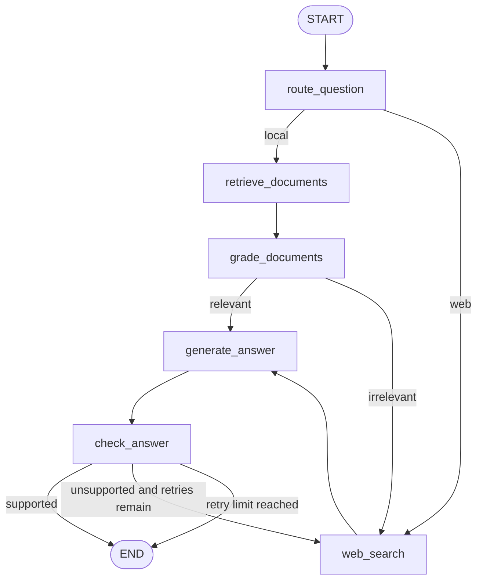

# Intelligent Adaptive RAG Assistant

This project demonstrates a stateful, conditional, and cyclic RAG workflow built with LangGraph.

## Run

```powershell
pip install -r requirements.txt
python app.py
```

The workflow works without API keys. Set `TAVILY_API_KEY` in `.env` to enable live web search; otherwise a deterministic fallback makes the graph runnable offline.

## Architecture



## LangGraph concepts used

- **State:** `RAGState` is shared by every node. It stores the question, retrieved context, answer, sources, grades, retry count, and execution trace.
- **Nodes:** Six required nodes perform one responsibility each: `route_question`, `retrieve_documents`, `grade_documents`, `web_search`, `generate_answer`, and `check_answer`.
- **Normal edges:** Retrieval leads to grading, web search leads to generation, and generation leads to checking.
- **Conditional edges:** The router chooses local or web retrieval, the document grader chooses generation or web search, and the answer checker chooses finish or retry.
- **Routing and loops:** The router decisions are state-driven. An unsupported answer loops through web search and generation, but `max_retries` guarantees termination.

## Evaluation

Run the required eight-question demonstration:

```powershell
python evaluation/test_questions.py
```

The output prints each answer and its trace, showing local-document paths and web-search paths. The local corpus is in `rag/vectorstore.py` and can be replaced with a real vector database without changing the graph contract.
